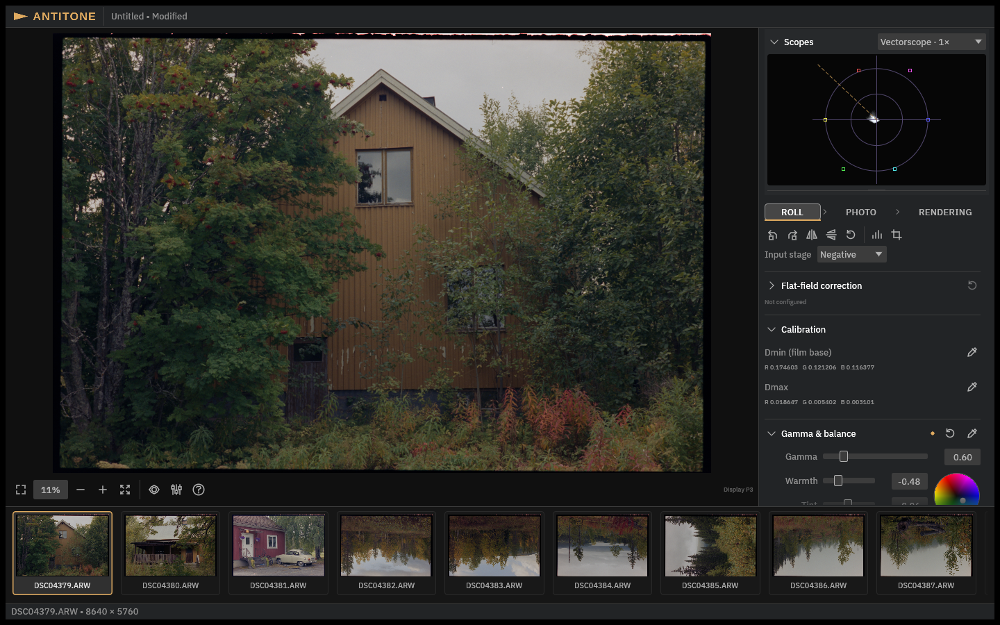

<h1>
  <picture>
    <source media="(prefers-color-scheme: dark)" srcset="assets/branding/wordmark-amber.svg">
    
  </picture>
</h1>

**An editor for camera-scanned film negatives.** Photograph your negatives with a digital
camera, and Antitone develops them into positive photographs you can grade with ordinary
photographic controls — and export as TIFF or EXR.

## Grading that behaves

Negative conversion usually means fighting sliders that correct someone else's image.
Antitone works from the camera's raw measurements and develops each scan into a proper
positive first, in a scene-referred, colour-managed workflow.

What that means in practice: **exposure acts like exposure, white balance acts like white
balance.** A stop is a stop across the roll, photographs from one roll match each other
before you touch them, and the exported TIFF is what you saw on screen.

**[The user guide](guide/README.md) teaches the workflow end to end** — add scans, let
Analyze establish the roll's starting grade, refine each photograph, export. It is written
for photographers, not developers.

## Download

Antitone is built for **Apple Silicon Macs running macOS 14 or later**.

Download `Antitone-macos-arm64.zip` from the [releases page](https://github.com/emil-e/antitone/releases),
unzip it, and move `Antitone.app` to Applications. The release also publishes
`SHA256SUMS` if you want to verify the download.

The build is not notarized by Apple yet, so macOS blocks the first launch. Antitone is
signed ad-hoc rather than with a Developer ID, which means one extra approval: try to
open it once, then allow it under **System Settings → Privacy & Security**, where macOS
lists the blocked app with an **Open Anyway** button. After that it opens normally.

## Current state

This is an early public release, and it says so honestly:

- Input is camera RAW from the accepted three-colour Bayer domain: Sony ARW (the
  ILCE-1M2 lossless-compressed baseline), Canon CR2/CR3 including CRAW, Nikon NEF,
  Olympus ORF and Panasonic RW2. Developed JPEG/TIFF/EXR import is not implemented.
- Negative and Digital RAW input stages share grading and export. Digital photographs
  need no negative calibration and can come from different cameras.
- One project is one roll; there are no catalogs.
- Dust cleanup is manual and provisional.
- macOS on Apple Silicon only for now; broader device coverage is still being tested,
  and the long-term goal is cross-platform.

## License

Antitone's original code is licensed under **MIT**; see [LICENSE](LICENSE) and [acknowledgments/distribution boundaries](NOTICE.md). Third-party code and assets retain their own terms.

## Contributing

Start with the [contributor guide](docs/README.md) — it routes you to
[build and run](docs/build-and-run.md), the topic guides and the checks.
