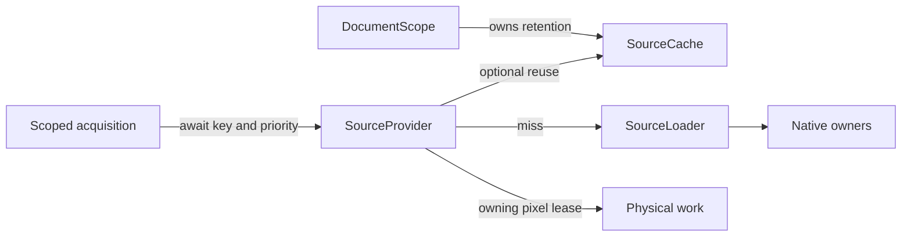

# Architecture: how the application runs

Antitone is one Rust package with small native bridges: LibRaw/OpenMP for RAW development, the Adobe DNG SDK behind the `dng-sdk` feature, Metal on macOS and Vulkan on Windows through wgpu, and generated OCIO references behind `ocio-reference`. Cargo features add persistence, RAW development, GPU processing, rendering, export and the editor, so a contributor can work on one boundary without building the desktop stack.

This guide owns the application's structure: how work executes, where state lives, and which rules keep it sound. What features *mean* is explained by the topic guides ([README](README.md)); the [module map](README.md#module-map) lives there too.

## The event loop owns the UI thread

[`platform/host.rs`](../src/platform/host.rs) runs the winit event loop on the main thread; per-platform modules own window-system integration through [macOS](../src/platform/macos.rs) AppKit and [Windows](../src/platform/windows.rs) Win32, including native menus and presentation. AppKit termination requests use [native quit negotiation](editor.md#native-quit-negotiation). The UI owns live document and view state, and a frame paint must stay fast: no RAW development, GPU waits or file IO happens inside a paint callback.

## Workflows: slow work without a backend thread

Long operations — opening a photo, calibration measurements, Analyze fitting, export — run as async tasks on a [`LocalExecutor`](../src/application.rs) on the UI thread, driven from winit wake events outside layout and painting. Features own their tasks and capture inputs at the UI action; [`UiContext`](../src/application.rs) provides short UI transactions around awaits. [Calibration](../src/editor/calibration.rs) and [white balance](../src/editor/white_balance.rs) supply display information and a measurement operation, then await the whole [interactive pick](../src/editor/picking/measurement.rs). Picking owns selection, measurement and failure feedback; the consuming feature owns validation, edits and history.

Three rules keep the borrow sound:

- **Capture inputs at the UI action.** A workflow reads its source, settings and destination from the captured request, never lazily from live state that can change under it.
- **Never hold an `Editor` borrow or `egui::Ui` across an await.** Use short read/update closures around the state you touch.
- **Updates request repaint; progress does not require a frame.** A completed development or fit proceeds even while nothing is being painted.

The host destroys pending futures before retiring application, window and GPU state, and `UiContext` holds only a weak executor reference, so a workflow cannot outlive what would wake it.

## Scopes: nested, disposable UI state

Editor state is nested scopes rather than one flat struct ([`editor_document_scope.rs`](../src/editor/document_scope.rs)):

| Scope | Owns |
| --- | --- |
| [`DocumentScope`](../src/editor/document_scope.rs) | Accepted data/history, [spatial metadata](spatial-metadata.md), source/thumbnail/grade retention, correction, cross-visit tool sessions and the dependent photo visit |
| [`PhotoScope`](../src/editor/photo_scope.rs) | Source readiness, working images/tasks, picker UI and consuming feature tasks, Crop/gradient/Dust interaction and donor searches, repair evaluation and visit-bound region consumers |
| [`GradeScope`](../src/editor/grade_scope.rs) | Effective photographic content and original-reconstruction demand, continuation and results |

Navigation creates fresh visits, dropping their transient tools and image ownership without accepting geometry or changing source-owned adjustments. Ordinary picking stays on the current photo; flat-reference sessions and Analyze reviews span visits under the document owner. Rejected navigation or failed candidates preserve the current visit. Document replacement drops its RAM retention; captured documents contain data, while physical jobs retain their required pixel leases through cleanup. Accepted state, drafts and durable preferences are separated in [editor](editor.md#accepted-state-and-drafts).

Document-owned export captures a batch of fixed recipes, resolved paths, correction and service handles. It acquires originals directly from the shared backend, one at a time, without preparing viewer resources or retaining a document cache. The current UI blocks document replacement and closing during export.

## Services and workers

Workflows never block; services run the work off the UI thread and workflows await typed results:

- **Synchronous work** runs on the shared blocking pool through [`background.rs`](../src/background.rs), with worker panics returned as errors. Each job owns its captured inputs; unrelated features can proceed concurrently.
- **Two native owners at most** ([`source/loader.rs`](../src/source/loader.rs)) serve foreground, visible and eager development; each runs one non-interruptible call with worker-local mutable RAW handles, and background work yields to foreground demand. [Scheduling rationale](native-development.md#editor-scheduling) describes the tradeoff.
- **Thumbnail processing** ([`production_worker.rs`](../src/editor/thumbnails/production_worker.rs)) awaits source acquisition, runs disk/CPU work on the shared blocking pool, and serializes ready processing by priority. GPU waits stay off the UI thread; obsolete tickets never install images.
- **Lazy photo preparation** ([`photo_preparation`](../src/photo_preparation.rs)) resolves Digital starting exposure before processed-positive publication. The document owns recorded values and per-photo initialization through [`exposure_metadata`](../src/exposure_metadata.rs); operations capture the completed value separately from shared native/proxy pixels. Camera preview display and metering share decoded leases and in-flight extraction. AP1 production folds the captured gain into its source transform.
- **The source cache** is a byte-bounded, oldest-unprotected LRU for native data, proxies and decoded camera references: active leases survive eviction, selected/visible proxies are protected separately, and native cache ownership is always optional. Retention settings and pressure behavior: [editor](editor.md#retention-settings-and-pressure).

Presentation follows the same separation: [`editor_activity.rs`](../src/editor/activity.rs) owns one foreground task-activity lifecycle (typed requests, progress, cancellation state), and [`editor_ui_dialogs.rs`](../src/editor/presentation/dialogs.rs) owns decision framing, button focus and dismissal — controllers keep the payloads and dispatch.

## Source acquisition and retention

The [`source` module](../src/source/mod.rs) separates retention from execution. `SourceProvider` acquires immutable native pixels, camera proxies and embedded previews through one object-safe interface. Cache-backed and cacheless implementations serve the same consumers:

[`SourceLoader`](../src/source/loader.rs) owns native execution and joining, independently of document stores. Cache misses forward the request's priority; joined work uses the highest active priority, so selecting a queued thumbnail promotes its existing load. Weak discovery of completed live results covers the handoff before cache publication. Waiting occupies no blocking-pool thread.

RAWs are treated as immutable while open. Import/Open captures file identity for persisted-cache validity; acquisitions reuse it. Cache lookup/publication and request joining are in-memory operations.

Each `DocumentScope` owns one [`SourceCache`](../src/source/cache.rs) and photo exposure initialization across same-document preparation, Save As and Undo. The owner binds [`providers`](../src/source/provider.rs); feature workflows receive acquisition capabilities. [Photo preparation](../src/photo_preparation.rs) resolves captured exposure separately from pixel compatibility. Blocking jobs receive pixel leases and captured inputs; optional retention stays with providers or the scope's continuation. New/Open prepares independently and seeds the accepted scope.

`SourceCache` owns weak live lookup and optional strong ownership under an LRU byte budget. Eviction preserves consumer leases; zero retention still permits live reuse. Retiring document-owned continuations releases their demand and retention references; running physical calls finish with their captured inputs. After every strong pixel reference disappears, reacquisition can develop again. Selected/visible protection applies to proxies, not full-resolution sources. [Retention settings](editor.md#retention-settings-and-pressure) govern optional ownership.

Camera display and exposure preparation share [`preview acquisition`](../src/source/preview.rs): one background extraction/decode serves async joiners. The worker owns decode inputs through completion; departing waiters leave other consumers intact. Decoded pixels use the same optional byte LRU as native/proxy data.

Analysis owns measured samples through fitting rather than a full-roll set of source leases.

## Results are proposals

Validate domain candidates before promotion. Interaction ownership withdraws unfinished work when its context ends; request IDs or generations distinguish superseded demand within a surviving owner where needed. Successful candidates promote atomically — the UI installs Analyze's support and grade together, or not at all.

### Cooperative cancellation

Each [`background::run`](../src/background.rs) wait owns a [cancellation signal](../src/cancellation.rs) passed to its blocking job. Dropping the waiting future signals stop; the job checks at safe checkpoints. Task retirement propagates when the executor destroys its future. Explicit user cancellation can also signal work while retaining the continuation for acknowledgement; analysis, region preparation and export own signals for that purpose.

These operations keep the continuation and cancelling feedback until acknowledgement. Owner retirement drops continuation rights while running work retains its inputs through cleanup. Dropping a source future retires that demand independently of joined consumers; running native calls finish on their owner. CPU work checks cancellation at its safe checkpoints. Return cancellation distinctly from failure, never by parsing diagnostic text, and preserve already-committed side effects as successes. [Development checks](development.md#cancellation-checks) exercise these boundaries.

## Native and GPU ownership

- **Native development is consumed, not shared.** A mutable `RawFile` stays worker-local; a successful development becomes private frozen native ownership. A [`Scan`](../src/scan.rs) leases an immutable `DevelopedSource` — native RGB16, Sony-corrected f32 or direct-SDK DNG f32 samples with original CFA and metadata — keeping its own illumination-correction context. Native leases remain stable across processing choices. Each `Scan` or prepared camera proxy carries its own fixed exposure value and correction context, so another document's baseline cannot mutate an existing consumer. Final destruction follows the last storage lease, including synchronized transfer to another thread.
- **One wgpu device/queue** serves view rendering, export and repairs; mutable processing state stays image/job-owned. The [bounded original-sample executor](../src/gpu/execution.rs) owns acquisition, processing, reconstruction and destination readback independently of file encoding. The shared submission gate ([`gpu_submission.rs`](../src/gpu/submission.rs)) excludes new submissions while wgpu drains GPU work during a resize.
- **Pipeline routing captures source execution separately from photographic constants.** A GPU source program and independent Roll/layer grade compose into an immutable execution plan; the CPU-side encoder binds their resources and can execute the stages in one compiled kernel. View state and metadata are excluded from photographic content identity. [Output](colour-and-output.md#tiff-and-exr-serve-different-purposes) owns reconstruction and lifetime detail.
- **Image recipes capture accepted intent** ([processing](processing.md#one-accepted-image-recipe)): viewer, reference, scopes and export share accepted repairs; [navigation thumbnails](editor.md#positive-thumbnail-reuse) prioritize inexpensive proxy rendering.

### Pixel stages and spatial support

[`PixelPipeline`](../src/pixel_pipeline.rs) holds ordered, value-identified layer definitions after photographic grading. Recipe assembly chooses their presence and order: Film Emulation supplies image MTF followed by active grain. Each layer declares support and composes its GPU implementation from contracted operations. To add a layer, implement that contract and insert it into recipe assembly; rendering consumers execute the supplied collection. This post-grade collection preserves its input grid and AP1 meaning, while a layer may use several internal passes.

Each stage declares its input neighbourhood at the raster's explicit grid pitch. Use that declared pitch for kernel preparation: recomputing lengths from rounded affine vectors can change finite radii. The pure [acquisition planner](../src/acquisition.rs) records backward per-stage dependencies, real-source reads and valid-output mapping, distinguishing original-cell support from processing-raster support.

Native export and regional references use original reads with valid-cell mappings. Shared [raster execution](../src/gpu/execution/raster.rs) applies source interpretation, photographic grading, original repairs and pixel stages for complete resident camera grids. Original tiles carry real-source support rather than treating their supplied edges as source boundaries. Export's [file adapter](../src/gpu_export/area.rs) selects scene-/display-referred processing and sample storage independently, then supplies the codec/publication sink. The [output guide](colour-and-output.md#tiff-and-exr-serve-different-purposes) explains rendering order and encoding.

The [footprint executor](../src/gpu/execution/footprints.rs) owns physical/proxy acquisition, neutral repair reconstruction, filtered grading/inspection and reusable stage resources. Its captured source request contains content identity and an immutable plan; presentation adds a separate publication ticket. Reuse checks content, representation, support and output layout, while composition and scopes still reject mixed tickets. Larger retained inputs can satisfy smaller demands without relabelling their grid. View/refinement adapters retain presentation and publication.

[Regional](../src/gpu/execution/regional.rs) and [native-output execution](../src/gpu/execution/originals.rs) pull original samples through interpretation/correction, repairs, grade, the supplied pixel layers, look and display. The [resident adapter](../src/gpu/pixel_pipeline.rs) composes those same pixel layers after its purpose-owned acquisition and grading. Both use the [planner](../src/gpu/pull/plan.rs) to lower demanded regions into symbolic resources and opaque GPU work. Function and callable-sampling contracts permit composition across logical image boundaries; materialized implementations remain available.

The [executor](../src/gpu/pull/execute.rs) admits GPU limits and budgets, binds resources and records work. Workers additionally use its bounded submission/completion loop; resident rendering records into the caller's encoder without submitting or waiting. Immutable uniforms and generated values may survive in a prepared composition; resident scratch lives through recorded commands rather than with the view. Explicitly writable resident inputs can become storage slots after their input lifetime ends. Compiled programs are renderer-owned; worker scratch and source leases remain job-owned.

Regional output uses bounded affine accumulation. Native output adds exact affine reconstruction as an operator and reads back destination blocks; its sink arms mapping after submission, before the common completion wait. Neither retains a full-source processed image or all tile plans. RAW decoding still produces a complete native source.

Acquisition clips to actual source bounds; their outermost cells extend constantly for filtering. Intermediate viewport, composition and tile edges retain the declared neighbours. Extract or reconstruct the requested output after processing, preserving the distinction between original-sample execution and neutral-footprint view approximations.

## UI test boundary

The opt-in `ui-tests` feature keeps egui_kittest cases in the Editor's private [test module](../src/editor/kittest_tests.rs). The harness invokes production `host::App::ui` and drives the live application between frames, independently of painting, on an RGBA16Float renderer that shares the real device/queue and submission gate.

The separate [native-host executable](../tests/native_host.rs) runs the production host and launches a window only with explicit `--run`. [Development checks](development.md#explicit-native-host-checks) distinguish that composition coverage from physical input and appearance acceptance.

## Finding the right explanation

[README](README.md) maps questions to topic guides and files. [Development](development.md) maps changes to checks; [build and delivery](build-and-delivery.md) maps the local setup/check/package workflow and its limits.
