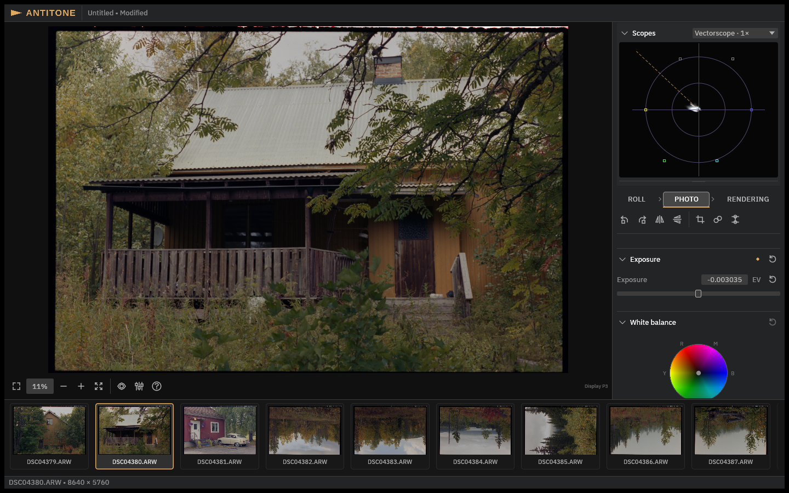
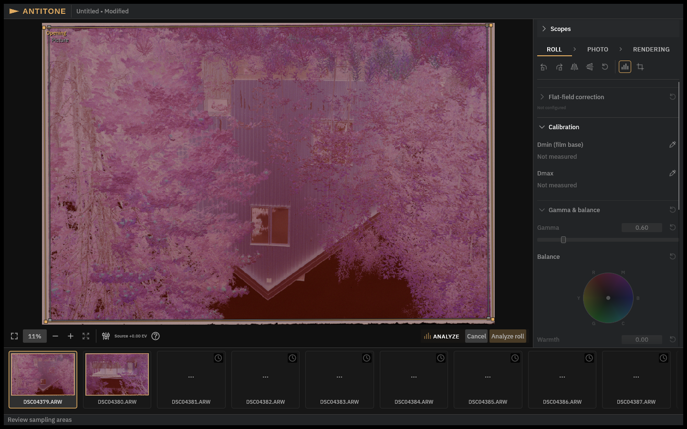

# Getting started

This walkthrough takes a card of camera scans to exported photographs. It assumes Antitone
is installed and launched (see the README's download section). The individual steps link
to the pages that explain each panel in depth.

## 1. Add your scans

Choose **File → Add Scans…** (⇧⌘I) and select the RAW files of one roll. Antitone adds
them to the project in the filmstrip along the bottom.

Your original files are referenced in place and never modified;
[projects and saving](projects.md) explains what a project stores and why the scans must
stay available.

## 2. Check the scan setup (Roll panel)

Open the **Roll** tab and look through the shared setup in order:

1. **Orientation** — use the turn and flip buttons on the Roll tool shelf until the
   photographs are upright.
2. **Flat-field correction** *(optional)* — corrects uneven scan illumination;
   [the Roll panel](roll.md) explains when you need it and how to set it up.
3. **Calibration** — Analyze measures this in the next step; manual picks are here
   ([the Roll panel](roll.md)).

See [The Roll panel](roll.md) for what each control does.

## 3. Let Analyze find a starting grade

Click **Analyze** on the Roll tool shelf. Antitone prepares sampling areas and opens a
**review**: the viewer shows each photograph with two outlined areas to check. Adjust any
area that is wrong, then confirm the complete set with **Analyze roll** (or press Enter).

> **Before you confirm:** Analyze replaces the roll calibration and all Photo grading,
> and **removes local adjustments and their masks** from analyzed photographs. The
> [Analyze](analyze.md) page explains the review and what exactly gets replaced.

Afterwards: "Adjust normally" — refine any photograph by hand.

## 4. Grade a photograph

Select a photo in the filmstrip and open the **Photo** tab. Exposure, white balance,
contrast and saturation work the way you expect; the tool shelf adds **Crop &
straighten**, **Dust repair** and local adjustments. Everything on this tab is
per-photograph — see [Grading a photograph](grading.md).

## 5. Choose the look and export

Open the **Rendering** tab to pick the project-wide **Look** and the **Target** output
colour space. Then **File → Export…** writes TIFF or EXR;
[Rendering and export](rendering-and-export.md) explains which format to choose and walks
through the export dialog.

## 6. Save as you go

**File → Save** (⌘S) writes an `.antitone` project as you work. See
[Projects and saving](projects.md).
