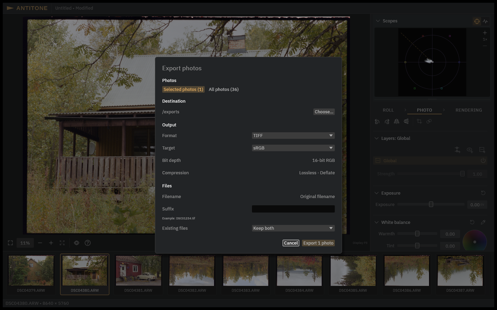

# Rendering and export

**Rendering** decides what the finished photograph looks like; **File → Export…** writes
it to disk. A display-rendered export uses the same look as the preview. Match the
preview's target to preserve its display colour.

## The Rendering panel

The sections follow processing order:

- **Film texture** — coupled image softness and grain, with separate halation. Presets
  populate starting values; edits retain those actual settings rather than a preset identity.
- **LUT** — **Load LUT…** imports a creative ACEScct/AP1 3D `.cube`, applied before
  Film & paper. Display and camera-conversion LUTs are not supported.
- **Film & paper** — **Negative** selects an optional simulated camera-negative stock;
  None skips selected-stock simulation, not the Roll panel's inversion of an actual negative.
  **Paper** selects the print medium independently. Paper None is available only without
  a selected negative. From bypass, a colour negative also selects Portra Endura; a B&W
  negative selects Ilford Multigrade RC Deluxe · filter 2. Choose Negative None to use
  paper alone on an already inverted scan or a Digital photograph. **Frontier A/B** are
  reproduction alternatives under Paper, compatible with colour negatives or None.
- **Target** — **sRGB** or **Display P3**, both 100-nit. This is the output colour space,
  not the monitor profile; choosing P3 changes the actual rendering and gamut limitation.

LUT and Film & paper are independent: use either, both or neither. A LUT can alter the
working positive before the film/paper response. Switching between colour and B&W asks
before clearing the negative or choosing a matching default paper. Changing a stock
prepares a new treatment in the background; Cancel keeps the accepted choices.

## Display-rendered or scene-linear?

- **Display-rendered** output is the finished photograph, with LUT and Film & paper
  applied. Use it for viewing, printing or delivery. The TIFF preset writes it in sRGB
  or Display P3 with an ICC profile.
- **Scene-linear** output is for continuing a grade or compositing in a scene-referred
  tool. It keeps source inversion, grading and Film texture, and skips LUT, Film & paper
  and display rendering. The EXR preset writes linear AP0 and declares that colour space
  in the file. It preserves values below black and above white within the selected
  float precision's range.

## Exporting

**File → Export…** opens the export dialog:

1. **Photos** — **Selected photos** (use the filmstrip selection) or **All photos**.
2. **Destination** — **Choose…** a folder.
3. **Output** — **Format** (TIFF/EXR). TIFF: **Target** (initialized from Rendering, but
   independently choosable per export), 16-bit RGB, lossless Deflate. EXR: **Precision**
   (half or full float).
4. **Files** — filename is the **Original filename**, with an optional **Suffix**; the
   dialog shows an example. For existing files choose **Keep both**, **Skip** or
   **Replace…** (replacement asks for confirmation once).

Click **Export N photo(s)**. Each photograph is rendered and written before the next
begins; a photo that fails does not stop the batch. The summary shows exported, skipped,
failed and remaining counts. On macOS, use **Show in Finder** to inspect the results.

Finish any active tool draft (crop, dust, an unapplied adjustment) before exporting —
exports use your applied settings.

## Good to know

- Exports read your **original scans** at full resolution — never the preview — so keep
  the RAW files available.
- Changing the export target does not change the preview or scopes, which continue to
  use the project's Rendering target.
