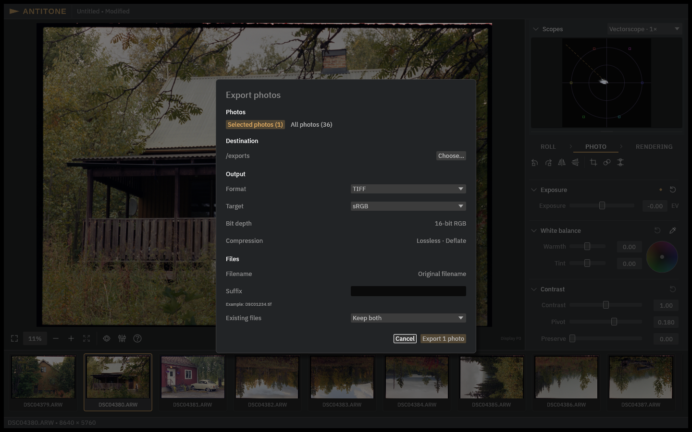

# Rendering and export

**Rendering** decides what the finished photograph looks like; **File → Export…** writes
it to disk. The preview is rendered through the same pipeline as the export — what you
see is what the file contains.

## The Rendering panel

Two project-wide choices:

- **Look** — a creative grade applied after your photographic grading: **None** (a true
  bypass), one of the built-in looks, or **Load LUT…** to use your own 3D `.cube` LUT.
  LUTs must be scene-referred (ACEScct/AP1 in and out) — display or camera-conversion
  LUTs are rejected on purpose, so a look can never silently break colour management.
- **Target** — the output colour space: **sRGB** or **Display P3**, both 100-nit. This is
  the *file's* colour space ("output colour space, not the monitor profile"): the
  photograph is rendered and limited for that target, which is why choosing P3 changes
  the actual rendering, not just a label.

## TIFF or EXR?

The two formats serve different purposes:

| | TIFF | EXR |
| --- | --- | --- |
| What it is | A finished, rendered photograph | The graded image in scene-linear form |
| Colour | sRGB or Display P3, with an ICC profile | Scene-linear AP0, always |
| Look / display rendering | Applied | Not applied (by design) |
| Use it for | Viewing, printing, delivery, further work in a colour-managed app | Further grading or compositing in HDR/scene-referred tools |
| Precision | 16-bit RGB, lossless Deflate | Half (16-bit) or full float (32-bit) |

Export TIFF when you want the photograph you see in Antitone. Export EXR when another
program will continue the grade — it deliberately skips the creative look and display
rendering so those are not baked in.

## Exporting

**File → Export…** opens the export dialog:

1. **Photos** — **Selected photos** (use the filmstrip selection) or **All photos**.
2. **Destination** — **Choose…** a folder.
3. **Output** — **Format** (TIFF/EXR). TIFF: **Target** (initialized from Rendering, but
   independently choosable per export), 16-bit RGB, lossless Deflate. EXR: **Precision**
   (half or full float).
4. **Files** — filename is the **Original filename**, with an optional **Suffix**; the
   dialog shows an example. For existing files choose **Keep both**, **Skip** or
   **Replace…** (replacement asks for confirmation once).

Click **Export N photo(s)**. Each photograph is rendered and written before the next
begins; a photo that fails does not stop the batch. The summary shows exported, skipped,
failed and remaining counts, with **Show in Finder** to inspect the results.

Finish any active tool draft (crop, dust, an unapplied adjustment) before exporting —
exports use your applied settings.

## Good to know

- Exports read your **original scans** at full resolution — never the preview — so keep
  the RAW files available.
- Everything is colour-managed end to end: the preview, the TIFF (which carries its ICC
  profile) and the scopes all follow the chosen Target.
- EXR output keeps headroom (values above white and below black survive), so a later
  grade in another tool has room to work. The file declares its own colour space, so
  the receiving application does not have to guess one.
