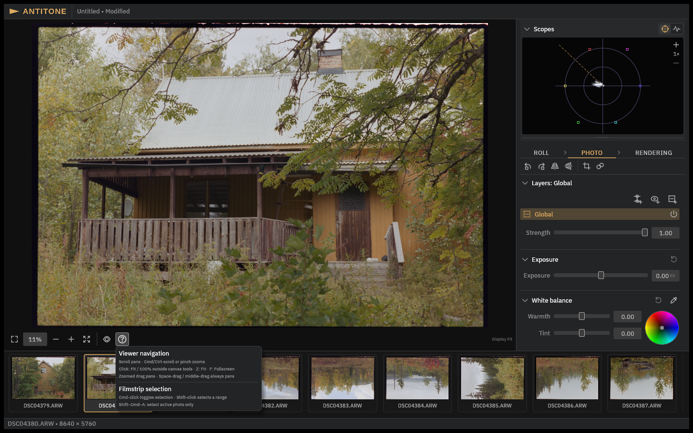

# The viewer

The viewer is where you look at the photograph; its controls sit in the bar above the
image. Every icon button shows its name and shortcut on hover, and the **Viewer help**
button (right end of the bar) lists navigation and the active tool's gestures.

## Navigation

- **Scroll pans; Cmd-scroll or pinch zooms.** When zoomed in, dragging with the mouse
  also pans; **Space-drag** or **middle-drag** always pans.
- **Fit** (Z, or ⌘0) fits the image in view; **100%** shows one image pixel per display
  pixel — the honest sharpness check. Clicking outside the canvas tools toggles
  Fit/100%.
- **Actual Size** (⌘1) and **Zoom In / Zoom Out** are in the **View** menu.

## Fullscreen

Press **F** — or use the viewer's fullscreen button, or **View → Photo Inspection** — to
enlarge the current viewer. Your active tool stays usable, including Crop handles and
area selection. The same viewer bar floats over the image with **Apply**, **Cancel** or
**Done**; move near the bottom or press **Tab** to reveal it after it fades.

**F or Escape returns** without applying or cancelling your draft. Navigation and viewing
changes carry back to the workspace. Fullscreen covers the current display without opening
a macOS fullscreen Space.

## Inspecting the source

- **View source** flips between your graded positive and the developed source, including
  while using a measurement picker. Pickers keep your current view and navigation.
  Negative's positive view requires Dmin/Dmax calibration.
- **Source inspection** adjusts viewing brightness and, for negatives, **Viewing WB**:
  Daylight by default, or As shot. Canvas and source-preview thumbnails share these
  settings; graded thumbnails stay positive. Inspection settings are not saved and do
  not affect calibration, grades or export.

## Selecting photos (filmstrip)

- **Cmd-click** toggles a photo in the selection; **Shift-click** selects a range.
- **Shift–Cmd–A** selects only the active photo.
- Selection drives export scope ("Selected photos") and bulk actions like auto-crop.

## Scopes

Open the **Scopes** disclosure above the stage tabs or choose **View → Show Scopes**.
Use the header icons to switch between **Vectorscope** and **Waveform**. Waveform settings
switch between **RGB** and **Luma**. On the vectorscope, use **+ / −** or scroll over the
plot to zoom from 1× to 8×.

The scopes measure the visible part of the image in the current output Target.

