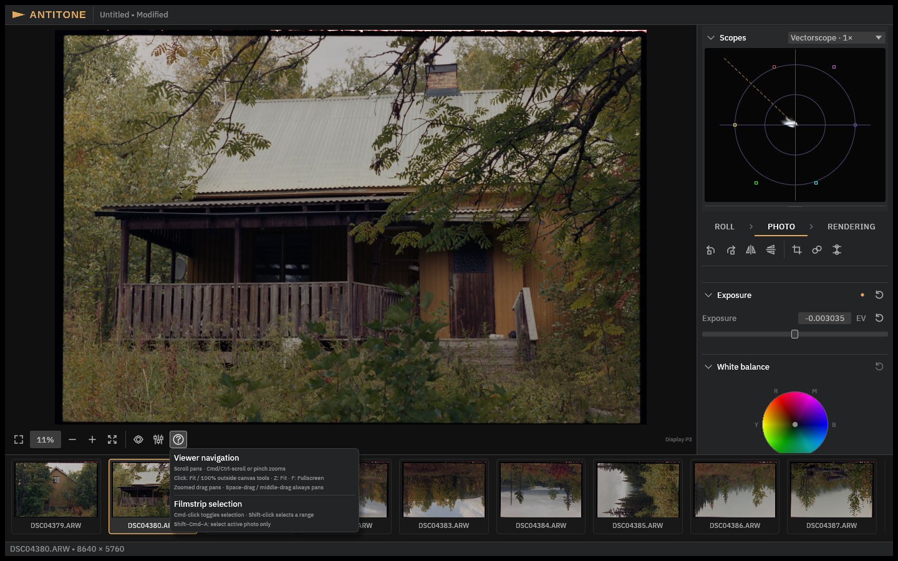

# The viewer

The viewer is where you look at the photograph; its controls sit in the bar above the
image. Every icon button shows its name and shortcut on hover, and the **Viewer help**
button (right end of the bar) lists navigation and the active tool's gestures.

## Navigation

- **Scroll pans; Cmd-scroll or pinch zooms.** When zoomed in, dragging with the mouse
  also pans; **Space-drag** or **middle-drag** always pans.
- **Fit** (Z, or ⌘0) fits the image in view; **100%** shows one image pixel per display
  pixel — the honest sharpness check. Clicking outside the canvas tools toggles
  Fit/100%.
- **Actual Size** (⌘1) and **Zoom In / Zoom Out** are in the **View** menu.

## Photo inspection (fullscreen)

Press **F** — or use the viewer's fullscreen button, or **View → Photo Inspection** — for
a photo-only view of the current image: the workspace chrome disappears so you can judge
the photograph. **F or Escape returns.** This covers the current display without opening
a macOS fullscreen Space.

## Comparing and inspecting

- **View source** flips between your graded positive and the developed source (as the
  camera recorded it). Useful while grading; the positive requires Dmin/Dmax calibration
  to exist.
- **Original-resolution reference** compares the working preview against full-resolution
  processing — export is unchanged either way, so this is purely a preview-sharpness
  check.
- **Source inspection** adjusts the source preview's brightness only ("relative to
  default source preview · not saved") — it is an inspection aid, not a photographic
  setting.

## Selecting photos (filmstrip)

- **Cmd-click** toggles a photo in the selection; **Shift-click** selects a range.
- **Shift–Cmd–A** selects only the active photo.
- Selection drives export scope ("Selected photos") and bulk actions like auto-crop.

## Scopes

**View → Show Scopes** (or the Scopes disclosure above the tabs) opens measurement
scopes: **Vectorscope**, **RGB waveform** and **Luma waveform**, with magnification up to
8×. They measure the rendered output of the current Target — what you see is what the
TIFF will contain. Scopes are for judging colour and exposure; they never change the
image.

